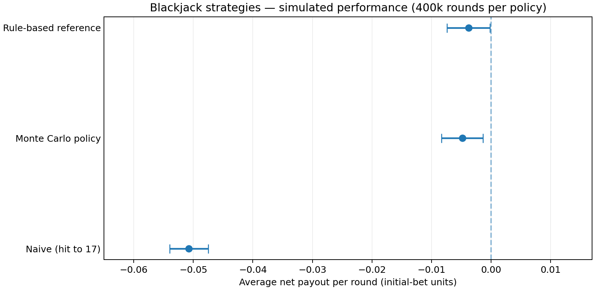

# Blackjack AI — Reinforcement Learning & Monte Carlo Evaluation

**A reproducible Python project for simulating blackjack strategies, training tabular agents, and assessing their performance against rule-based baselines.**

*Author: Axel Brunel · Data Science / Machine Learning portfolio project*

[Lire l'analyse en français](docs/ANALYSE_FR.md) · [Benchmark data](reports/summary.csv) · [Reproduction instructions](#quick-start)



## Why this project?

How well can a policy learned from simulated experience approximate a domain-specific, hand-crafted strategy?

Instead of relying on a prebuilt blackjack library or dataset, this project implements its own game simulator, rule-based strategies and Monte Carlo training loop. It also contains an **earlier, separate tabular Q-learning implementation**. These approaches should **not** be confused: the saved model evaluated below comes from the Monte Carlo first-action training pipeline, not from the `QLearningAgent` module.

The emphasis is on **Python design, simulation, model training, experimental evaluation and methodological limitations**, not on claiming a winning gambling system.

## Results — reproduced independently from the supplied code

The benchmark compares four policies on **400,000 simulated rounds each** (200,000 rounds with seed 42 plus 200,000 with seed 2026), under the engine's default settings.

| Strategy | Avg. net payout / round | Approx. 95% CI |
|---|---:|---:|
| Random | −0.44888 | [−0.45296, −0.44481] |
| Naïve (hit to 17; double on 11) | −0.05074 | [−0.05396, −0.04752] |
| Rule-based reference | −0.00378 | [−0.00737, −0.00019] |
| Monte Carlo policy (1M training episodes) | −0.00481 | [−0.00829, −0.00133] |

**Interpretation:** the learned Monte Carlo policy reaches a similar performance range to the simplified rule-based reference in this simulator. There is **no demonstrated statistically significant superiority** of the learned policy. The comparison also illustrates how much stronger both structured approaches are than a random decision policy in this environment.

**Methodological cautions:**
- Returns are **net payout per original round**, expressed as multiples of the initial bet, not a percent win rate. Splits and doubles change risk and the number of resulting hands.
- Intervals are **rough normal confidence intervals** treating successive rounds as independent; rounds sharing a shoe are not fully independent. Do not treat the limits as a rigorous statistical guarantee.
- The simulator's blackjack rules are configurable, but not every flag is implemented. The rule-based class is named `OptimalStrategy` in the source for historical reasons; it is **a simplified basic strategy**, not a proven mathematical optimum.
- Training and evaluation use **different shoe dynamics**: training typically starts a fresh shoe each episode, while evaluation reuses a shoe until its cut card.
- The MC training loop estimates the value of the **initial action**, with a fixed continuation policy thereafter; the inference wrapper may consult the learned table on subsequent decisions. This **training/deployment policy mismatch** is a documented limitation and an avenue for future work.
- Simulation results do not imply a real-world betting advantage.

Raw outputs are preserved in `reports/benchmark_200k_seed42.json`, `reports/benchmark_200k_seed2026.json` and `reports/summary.csv`.

## Architecture

```text
                     BlackjackRules
                            │
                 Shoe / Hand / BlackjackGame
                            │
          ┌─────────────────┼───────────────────┐
          │                 │                   │
      Baselines        RL environment     Monte Carlo training
   random / naïve      tabular Q agent     first-action values
   rule-based               │                   │
          │                 └───────────┬───────┘
          │                             │
          └───────────── Simulation / benchmark
                                        │
                              JSON/CSV + chart + tests
```

### Components

| Path | Purpose |
|---|---|
| `Proj/src/blackjack/` | Blackjack rules, deck/shoe, hands, game engine and card-counting utilities |
| `Proj/src/strategies/` | Random, naïve, simplified rule-based, Monte Carlo and hybrid agents |
| `Proj/src/rl/` | Separate tabular Q-learning environment and agent |
| `Proj/src/analysis/` | Policy comparison, expected-value experimentation and simulation |
| `train_q_learning.py` | **Legacy name**: trains *Monte Carlo initial-action* model (not tabular Q-learning) |
| `run_tuning.py`, `test_params.py` | Experiment and hyperparameter exploration scripts; computationally expensive |
| `run_simulation.py` | Original fixed-size strategy comparison script (1M rounds per policy) |
| `scripts/benchmark.py` | Reproducible, configurable comparative benchmark using safe JSON model data |
| `scripts/summarize_benchmarks.py` | Combine independent benchmark output files |
| `models/selected_mc_policy.json` | Selected, portable MC policy: 340 observed state entries |
| `Proj/models/rl/` | Historical small pickle model snapshots from the original project |
| `tests/` | Regression checks and clearly marked expected failures for unfinished rule variants |

## Quick start

Python **3.10+** is required. The game simulation and JSON-based benchmark use only the standard library.

```bash
# macOS / Linux
python3 -m venv .venv
source .venv/bin/activate

# Interactive blackjack against the engine
python3 main.py

# Evaluate 4 policies on 10,000 rounds each
python3 -m scripts.benchmark --rounds 10000 --seed 42

# Save machine-readable results
python3 -m scripts.benchmark --rounds 200000 --seed 42 \
  --output reports/my_benchmark.json
```

To run the regression suite and optionally regenerate the chart:

```bash
python3 -m pip install -r requirements-dev.txt
python3 -m pytest -q
python3 -m scripts.make_chart
```

To reproduce the **full 400k/strategy** aggregate (longer run):

```bash
python3 -m scripts.benchmark --rounds 200000 --seed 42 \
  --output reports/benchmark_200k_seed42.json
python3 -m scripts.benchmark --rounds 200000 --seed 2026 \
  --output reports/benchmark_200k_seed2026.json
python3 -m scripts.summarize_benchmarks \
  reports/benchmark_200k_seed42.json \
  reports/benchmark_200k_seed2026.json \
  --output reports/summary.csv
```

**Pickle safety:** the original scripts load `.pkl` model files; **never unpickle models from untrusted sources**. For normal benchmarking prefer the checked-in JSON representation.

## Example decisions

The two agents often agree, but not always. These examples were generated from their current implementations; they are **not optimal-play recommendations**.

| Player hand | Dealer upcard | Rule-based | Monte Carlo |
|---|---:|---|---|
| 10 + 2 | 4 | Stand | Stand |
| 6 + 5 | 6 | Double | Double |
| A + A | 6 | Split | Split |
| 10 + 6 | 10 | Hit | Stand |
| 8 + 8 | 6 | Split | Stand |
| A + 7 | 3 | Double | Hit |

See the complete small comparison in `reports/decision_examples.csv`. The disagreements make for useful error analysis: exploration, sparse observations, state representation and differences between training and deployment can all affect the chosen action.

## Known limitations and work in progress

- The first-action Monte Carlo pipeline does not learn a full multi-step policy.
- The training distribution (reshuffled shoe per episode) differs from the evaluation distribution (persistent shoe).
- Certain flags defined in `BlackjackRules` are not yet enforced, including restricted doubles and one-card-only split Aces.
- Surrender and insurance are not playable in the main engine.
- Rules such as splits, payouts, dealer peek and reward modelling deserve broader property-based tests and empirical verification.
- Results currently use two simulation seeds and approximate CIs; a stronger statistical comparison would use repeated independent runs, within-shoe dependence handling and a predeclared evaluation protocol.
- The optional expected-value and tuning utilities are experimental and have not all been fully validated.

The test suite explicitly marks two rule gaps as `xfail`, rather than silently presenting complete coverage.

## Possible next iterations

1. Align inference with the initial-action-plus-fixed-continuation policy used for MC training.
2. Move to a sequential policy for **hit / stand / double / split**, with an environment that correctly tracks all hands and actions.
3. Standardize the training/evaluation shoe rules, add confidence intervals from independent shoes and run sensitivity analyses.
4. Evaluate agents across multiple seeds and compare state/action-level decisions to a strong external basic-strategy table (with matching rules).
5. Build an interactive Streamlit dashboard for strategy visualisation and game inspection.

## Project provenance

The blackjack engine, baseline strategies, training/tuning experiments and original model artifacts come from the author's supplied project. For this GitHub-ready version, additional work included **repository clean-up, an independent benchmark runner, a portable JSON model, reproducibility reports, a README, documentation and regression tests**. One pre-existing dataclass issue preventing `test_params.py` from importing was corrected without changing the underlying experiment design.

No guarantee of casino-level accuracy or real-money profitability is made. License not specified; the repository author should choose a license before permitting third-party reuse.
